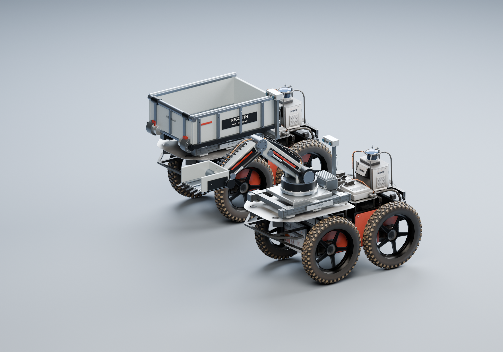

# EXPLORER R2 采矿与运输改装车

两辆车直接复用项目中 EXPLORER_R2_SENSOR_CONFIG_1 的原始车体、四轮网格、中央摆动关节和 PBR 贴图，在后部平台上加装工作装置。



另有[正面预览](../assets/models/mining_vehicles_front.png)、[Gazebo Ogre2 实际截图](../assets/models/mining_vehicles_gazebo.png)和[可编辑 Blender 文件](../assets/models/mining_vehicles.blend)。Blender 采用摄影棚灯光；Gazebo 截图来自专用检查场景，照明效果不同。

## 模型与结构

| 模型 | 工作装置 | 空载仿真质量 |
| --- | --- | --- |
| `lunar_excavator` | 回转台、肩部/肘部俯仰、铲斗俯仰，共 4 个受控关节 | 218.976 kg |
| `lunar_hauler` | 后铰链翻斗、独立上铰链尾门，共 2 个受控关节 | 215.889 kg |

- 原车共享资源保存在 `assets/models/explorer_r2_base`；原始 DAE、贴图、SDF 均保留字节一致的副本。两辆改装车分别有自己的 `model.config`、SDF 和工作装置 GLB。
- 新框架固定在 `Rear_Rocker_Link` 上，随原车后车体摆动；保留原中央关节，避免把前后车体用刚性框架跨接锁死。
- 采矿臂默认朝车尾，回转范围为后方左右约 90°。工作装置包含轴承法兰、螺栓、减速器外壳、线缆、铲齿与耐磨板；料斗包含加强筋、衬板、卷边、尾门铰链和旋转翻斗驱动外壳。
- 后向 RGB-D 相机 `rs_back` 移至新增相机杆；运输车相机安装在料斗外侧，上沿之上，不侵入货舱与翻斗运动空间。IMU、其他 RGB-D 相机和激光雷达保留。工作装置仍可能遮挡原车低位传感器的部分视场。
- 工作装置使用逐连杆惯量和简化碰撞体；铲斗与料斗保留空腔，不用整块凸包封住内部。轮距按原车左右轮心间距设为 0.726 m，轮半径 0.31 m。
- 原车灯默认关闭，隐藏绿色灯光辅助框；需要夜间作业时，可将对应 `<light_on>` 改为 `true`、`<intensity>` 改为 `1`。

原车资源由 Team Explorer 提供、OpenRobotics 发布，采用 CC BY 4.0。归属、原始来源和修改说明见 [ATTRIBUTION.txt](../assets/models/explorer_r2_base/ATTRIBUTION.txt)。这些是项目的概念改装车，不是官方采矿车复刻。

## 打开展示场景

在仓库根目录执行；单独命名容器，便于与原场景区分：

```bash
GAZEBO_CONTAINER=space-robotics-mining bash .docker/local.bash start mining_vehicles
```

关闭：

```bash
GAZEBO_CONTAINER=space-robotics-mining bash .docker/local.bash stop
```

已有本机 Gazebo Ionic 时，也可直接运行：

```bash
export GZ_SIM_RESOURCE_PATH="$PWD/assets/models:$PWD/assets/cache:$PWD/worlds${GZ_SIM_RESOURCE_PATH:+:$GZ_SIM_RESOURCE_PATH}"
gz sim worlds/mining_vehicles.sdf
```

`worlds/mining_vehicles.sdf` 是月球重力下的平整检查场景，含两车和检查用补光；资源均已随项目放在 `assets/models`，不需要再次下载 Fuel 模型。

## 控制

默认话题随模型名隔离。以下命令假设使用上面的 Docker 启动方式；原生 Gazebo 去掉 `docker exec space-robotics-mining` 前缀即可。

```bash
# 低速行驶：linear.x 单位 m/s，angular.z 单位 rad/s
docker exec space-robotics-mining gz topic -t /model/lunar_excavator/cmd_vel \
  -m gz.msgs.Twist -p 'linear: {x: 0.15}, angular: {z: 0}'

# 停车：速度命令会保持，需主动发零
docker exec space-robotics-mining gz topic -t /model/lunar_excavator/cmd_vel \
  -m gz.msgs.Twist -p 'linear: {x: 0}, angular: {z: 0}'

# 铲斗翻转
docker exec space-robotics-mining gz topic -t /model/lunar_excavator/joint/bucket_pitch/0/cmd_pos \
  -m gz.msgs.Double -p 'data: 0.6'

# 先打开尾门，再抬起料斗
docker exec space-robotics-mining gz topic -t /model/lunar_hauler/joint/tailgate_hinge/0/cmd_pos \
  -m gz.msgs.Double -p 'data: 1.2'
docker exec space-robotics-mining gz topic -t /model/lunar_hauler/joint/bed_tilt/0/cmd_pos \
  -m gz.msgs.Double -p 'data: -0.6'
```

关节角均为相对 SDF 初始装配姿态的弧度值，发 `data: 0` 回初始姿态。运动前先停车；这些关节限制不等于机械臂的完整防碰撞规划。

| 模型 | 关节 | 范围（rad） |
| --- | --- | --- |
| 采矿车 | `shoulder_yaw` | -1.57 ～ 1.57 |
| 采矿车 | `shoulder_pitch` | -0.8 ～ 1.35 |
| 采矿车 | `elbow_pitch` | -1.6 ～ 1.0 |
| 采矿车 | `bucket_pitch` | -1.5 ～ 1.7 |
| 运输车 | `bed_tilt` | -0.95 ～ 0 |
| 运输车 | `tailgate_hinge` | 0 ～ 1.6 |

关节反馈：`/world/mining_vehicles/model/<模型名>/joint_state`。传感器沿用 Gazebo 的模型/连杆命名空间，可用 `gz topic -l` 查找。

## 修改与验证

`tools/models/build_explorer_variants.py` 从原始 Fuel 缓存生成两辆车的 SDF；`payloads.sdf` 保存工作装置的原始尺寸与物理配置，构建时统一缩放到 0.7。原车尺寸不缩放。工作装置的 GLB 是已提供的源资产，构建脚本不重新生成它们。

```bash
.venv/bin/python tools/models/build_explorer_variants.py
.venv/bin/python tools/models/prepare_preview_geometry.py
```

随后用 Blender 4.3 执行 `tools/models/render_explorer_variants.py`，重新生成安装框架网格、预览图与已打包贴图的 `.blend`。该脚本直接加载 SDF 与原始 COLLADA 的顶点、法线、UV，因此预览和仿真使用同一套几何资源。

静态检查：

```bash
.venv/bin/python -m pytest tests/models -q
```

已有项目 Ionic 训练镜像时，运行有限时长的落地、行驶、转向与关节测试：

```bash
docker run --rm --network host --entrypoint python3 \
  -v "$PWD:/root/ws:ro" space-robotics-rl:ionic \
  /root/ws/tools/models/check_explorer_variants.py
```

验证结果保存在 [mining_vehicles_validation.json](mining_vehicles_validation.json)。`capture_gazebo_preview.py` 使用隔离的 Gazebo 服务检查 Ogre2 实际渲染，自动退出；渲染检查使用静止副本，动力学由独立测试验证。

目前具备车辆行驶和工作关节控制。尚未加入土壤切削/颗粒、矿物生成与装载、自动挖掘装车流程，以及这些新车型的 PPO 训练接入；新增工作装置质量和惯量是仿真设计值，尚无实车载荷或强度验证。
